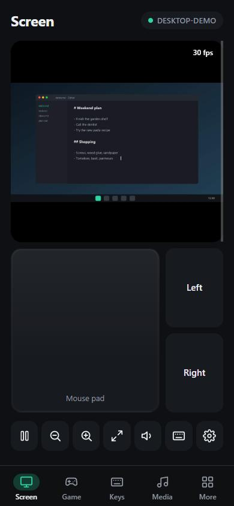
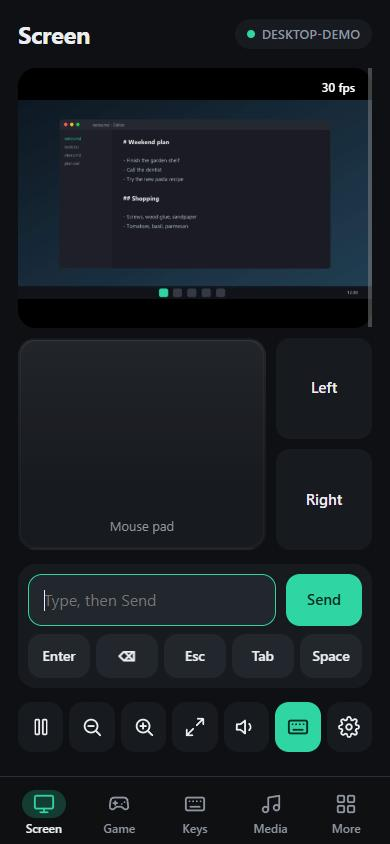
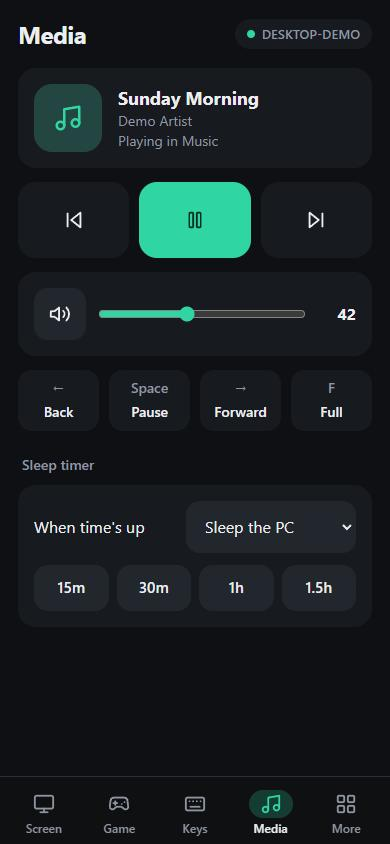
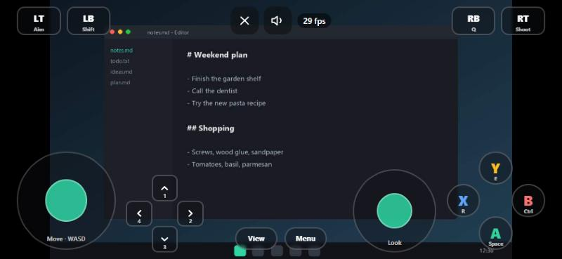
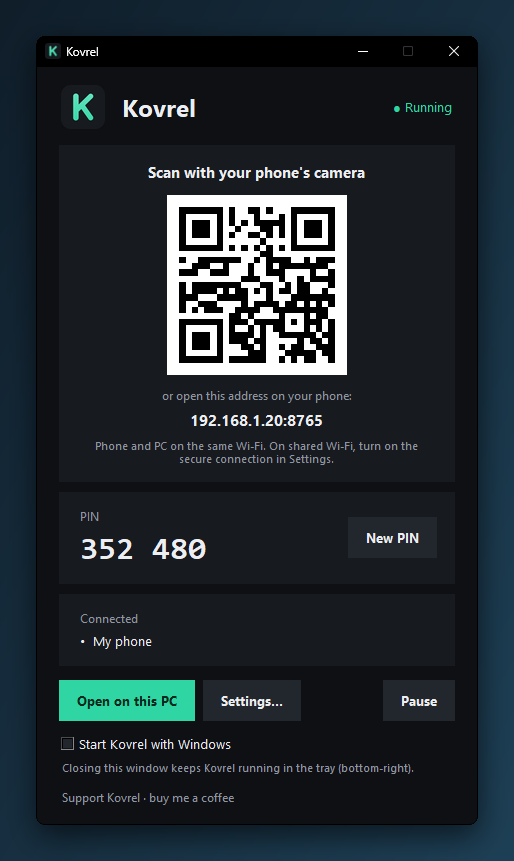
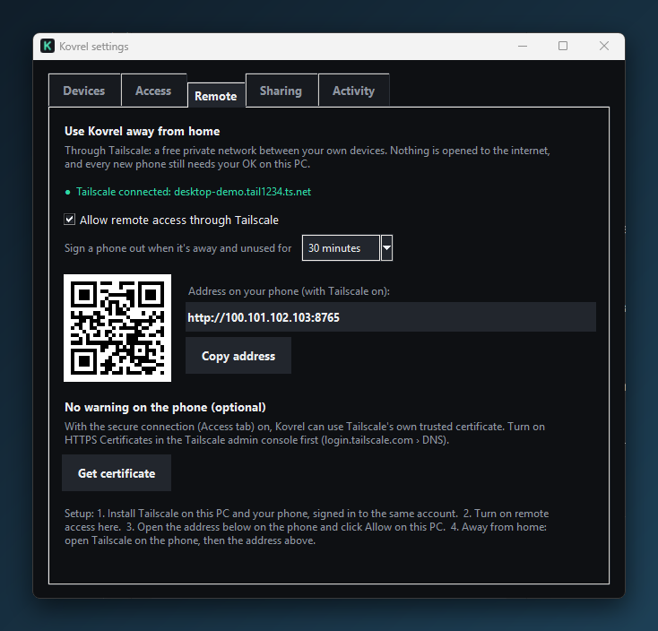

# Kovrel

Control your Windows PC from your phone. No phone app, no account, no cloud.

Kovrel runs a small program on your PC. Your phone opens it in the browser (scan the QR code),
and you get the PC's screen, a touchpad, a keyboard, media keys, a game controller and more.
Everything stays between your phone and your PC.

<p align="center">
  
  
  
</p>
<p align="center">
  
</p>

<sub>Screenshots use made-up data (a demo desktop, track and PC name), made with `tools/demo_server.py` and `tools/demo_windows.py`.</sub>

## Features

- **Screen**: live view of the PC (about 30 fps on good Wi-Fi), tap to click, long-press to right-click,
  zoom, drag mode, full screen, any monitor, full-quality screenshots
- **Touchpad and keyboard**: trackpad gestures, typing and voice typing, shortcuts, sticky Ctrl/Alt/Shift/Win,
  clipboard both ways
- **Game controller**: an Xbox- or PlayStation-style controller over the PC's screen. It sends keyboard and
  mouse input, or acts as a real virtual controller if you install the free ViGEmBus driver. Layouts
  are saved per game and switch automatically.
- **Media**: play/pause, next, volume, what's playing, sleep timer, the PC's sound on your phone
- **More**: per-app volume, monitor brightness, open windows and apps, running programs, files both ways,
  your own buttons and macros, PC status, notifications, lock/sleep/shut down, wake another PC
- **Remote access (optional)**: use it away from home through [Tailscale](https://tailscale.com), without
  opening anything to the internet

## Install

1. Download `Kovrel-Setup.exe` from [Releases](../../releases) and run it. It installs for your Windows
   user only; no administrator rights are needed.
2. The first time Kovrel starts, Windows asks whether it may use the network. Click **Allow**.
3. Scan the QR code in the Kovrel window with your phone's camera. Phone and PC must be on the same Wi-Fi.
4. Enter the PIN shown on the PC, then click **Allow** on the PC. Each new phone needs that OK once.

Tip: in your phone's browser, use *Add to Home Screen* and Kovrel opens like an app.

<p align="center">
  
</p>

Releases up to 2.0.1 are not code-signed, so Windows may show "Windows protected your PC". Click
**More info › Run anyway** (see the [code signing policy](#code-signing-policy) for what changes). Compare
the file's SHA-256 with the one on the release page first if you want to be sure:

```powershell
Get-FileHash .\Kovrel-Setup.exe -Algorithm SHA256
```

## Using it away from home

1. Install Tailscale on the PC and on your phone, and sign in to the same account on both.
2. On the PC: **Kovrel › Settings › Remote**, then turn on remote access. It asks for a password of at
   least 12 characters, which replaces the 6-digit PIN.
3. With Tailscale on, open the address shown in the Remote tab on the phone (or switch the main
   window's QR code to **Away**), sign in, and click **Allow** on the PC once. Your phone saves its sign-in
   separately for each address, so do this step at home with the Tailscale address.

<p align="center">
  
</p>

Do not forward Kovrel's port on your router. Kovrel refuses connections from the open internet on
purpose, so it won't work that way.

## Security in short

- Every new phone must be allowed on the PC itself.
- The PIN is only used to sign in. After that, each phone has its own session, which you can revoke
  in **Settings › Devices**.
- Wrong PINs lock that address out for longer each time. Many wrong attempts pause all logins.
- **Pause** (main window or tray menu) stops all control instantly; phones can still look.
- An optional secure connection (HTTPS) encrypts traffic on your home network. Over Tailscale,
  traffic is always encrypted.
- Phones can only open the folders you share; everything else on the PC stays off-limits.

See [SECURITY.md](SECURITY.md) for the full model and how to report a problem, and [PRIVACY.md](PRIVACY.md)
for what is stored where.

## Honest limits

- **Windows 10/11 only.** No Mac or Linux version.
- **Some games block it.** Kovrel types and moves the mouse the way other Windows programs do
  (`SendInput`). Games with kernel-level anti-cheat (for example Valorant) may block or flag that input.
  Don't use it where the game's rules forbid input tools.
- **The PC must be on and awake.** When the PC sleeps, Kovrel sleeps with it.
- **Smooth H.264 video needs a secure page.** Phone browsers only allow it over HTTPS (Settings › Access,
  or Tailscale's certificate), and only if your Windows has its built-in H.264 encoder (some "N" and Server
  editions don't). Otherwise the screen is sent as JPEG pictures: very compatible, but several times more
  data (roughly 1–6 MB/s). Kovrel picks by itself; **Screen settings › Video** can force JPEG. Away from home,
  Kovrel starts with a smaller picture.
- **The home-network HTTPS certificate is made by your PC**, so phones show a one-time warning. With
  Tailscale's certificate (Settings › Remote) there is no warning.
- **The virtual controller** needs the free [ViGEmBus](https://github.com/nefarius/ViGEmBus/releases)
  driver, which you install yourself. That project is no longer maintained but still works.

## Run from source

```powershell
py -3.12 -m pip install -r requirements.txt
py -3.12 Kovrel.pyw            # the app (or: py -3.12 server.py for a console-only server)
py -3.12 tests\run_all.py      # tests; they use throwaway settings and never touch yours
py -3.12 installer\build.py    # builds build\Kovrel-Setup.exe
```

`KOVREL_PORT` changes the port (default 8765).

## Code signing policy

Free code signing provided by [SignPath.io](https://about.signpath.io/), certificate by
[SignPath Foundation](https://signpath.org/) (being set up; releases after 2.0.1 will be signed).

- Installers are built from this repository's source by [GitHub Actions](.github/workflows/release.yml),
  never on a personal PC. Only `Kovrel.exe` and `Kovrel-Setup.exe` are signed; the bundled Python runtime,
  libraries and `ViGEmClient.dll` are upstream files and keep their own signatures (or none).
- Every signing request is approved by hand.
- Committers and reviewers: [Nyxaliths](https://github.com/Nyxaliths)
- Approvers: [Nyxaliths](https://github.com/Nyxaliths)

Privacy: Kovrel will not transfer any information to other networked systems unless you ask it to, except
the daily update check, which asks GitHub whether a new version exists and can be turned off. See
[PRIVACY.md](PRIVACY.md).

## License

[MIT](LICENSE). Kovrel bundles `ViGEmClient.dll` (MIT); see [vendor/NOTICE.txt](vendor/NOTICE.txt).
